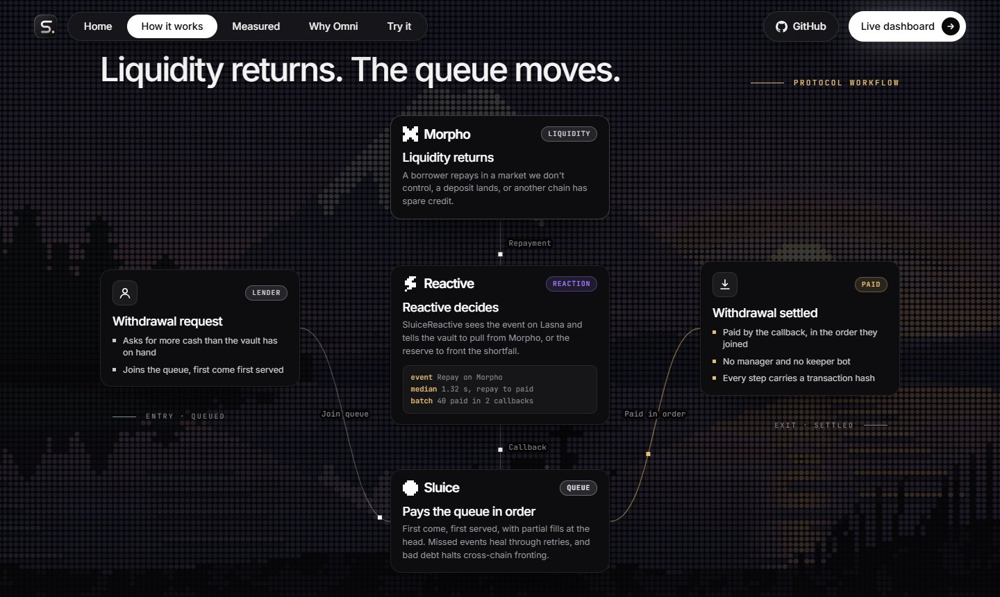
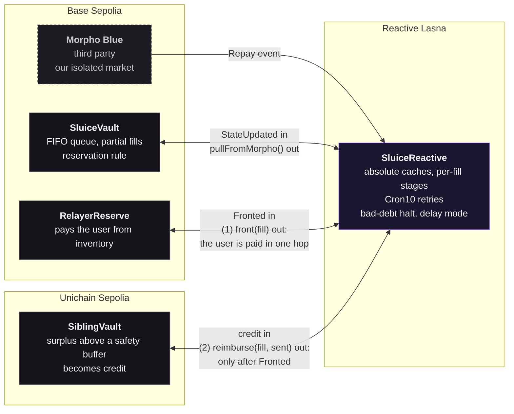
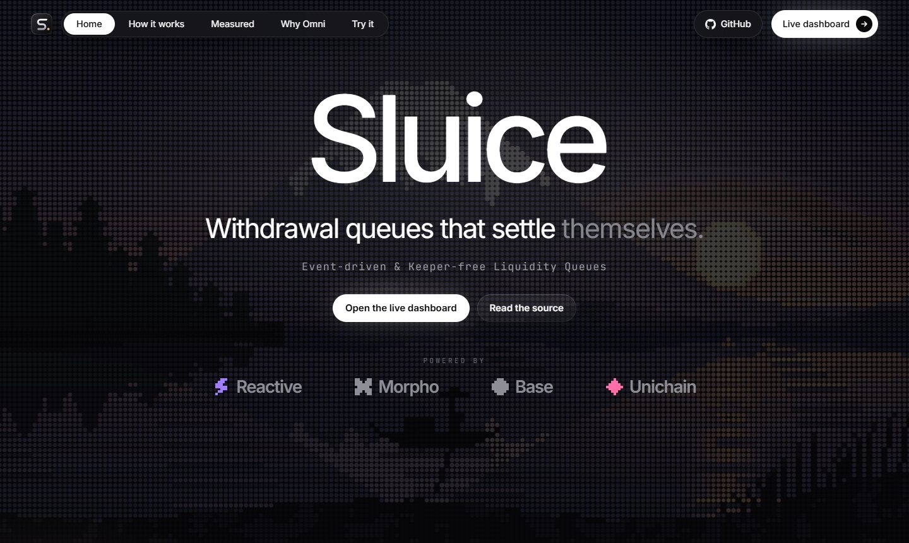
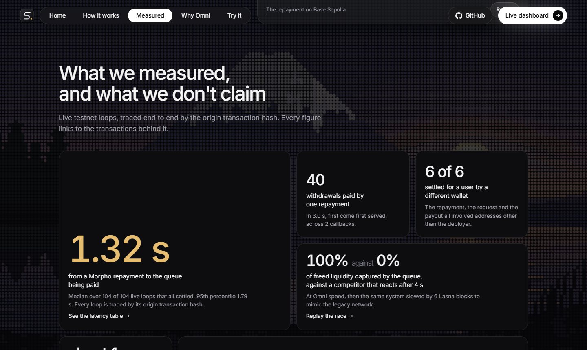
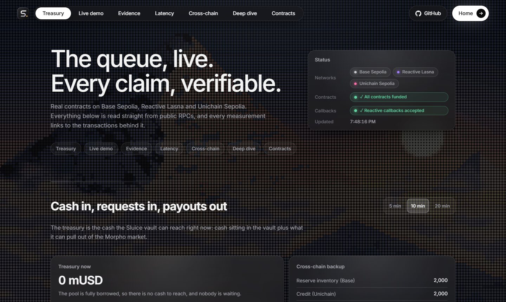

<h1 align="center">Sluice</h1>

<p align="center"><b>Withdrawal queues that settle themselves.</b></p>

<p align="center">
  <a href="https://github.com/isithore002/Sluice/actions/workflows/test.yml"></a>
  <a href="LICENSE"></a>
  
  
  
</p>

<p align="center"><b><a href="https://sluice-eight.vercel.app">Live site</a></b> · <a href="#try-it-yourself">Try it yourself</a> · <a href="#results">Results</a></p>

<p align="center"></p>

When a lending vault runs out of free cash, withdrawals queue up. Today someone (a manager, a keeper bot) has to notice when cash comes back and pay the queue, and in a crunch whoever runs the fastest bot grabs freed liquidity first. Sluice replaces that operator with a Reactive contract. It watches every place liquidity can come back from and pays the queue **first come, first served, within seconds**. Liquidity comes back from:

- a repayment in a Morpho Blue market Sluice doesn't control;
- spare credit in a sibling vault on another chain;
- a new deposit.

Built for the [Reactive Omni Buildathon](https://dorahacks.io/hackathon/reactive-omni-buildathon), track **Every Second Counts**. The track's [announcement](https://blog.reactive.network/reactive-omni-buildathon-thirty-days-to-find-out-what-one-second-buys/) lists, among its example ideas, *"vaults that rebalance as conditions shift, or withdrawal queues that settle the moment they can."* Sluice is the second, and its cross-chain flow is a form of the first.

| | |
|---|---|
| Networks | Reactive Lasna (5318007), Base Sepolia (84532), Unichain Sepolia (1301) |
| Protocol integrated | Morpho Blue (the live deployment on Base Sepolia, `0xBBBB…FFCb`) |
| Tests | 90 passing, against **Morpho's real bytecode** and **the real Omni system contracts** |
| Results | Live on testnet: **one repayment paid 40 queued withdrawals** in two callbacks (25 + 15, first come first served, 2.97 s); 104/104 flow B loops; flow C **32 of 32 completed** (31 timed, [why](#the-cross-chain-loop-that-is-not-in-the-numbers)); a 60-round latency race. See [Results](#results) |

### Check it in two minutes

| I want to… | Go to |
|---|---|
| **Open the site** | [sluice-eight.vercel.app](https://sluice-eight.vercel.app) is the story and its measured numbers. Its dashboard section reads the contracts on all three chains (run it locally: see [Landing page and dashboard](#landing-page-and-dashboard)). |
| **See it work without trusting us** | [Try it yourself](#try-it-yourself): three `cast` commands from a throwaway wallet, or the dashboard's wallet buttons. Reactive pays the queue about two seconds later, and the payout is sent by Reactive's signer, not by us. |
| **See the numbers** | [Results](#results): 104 live loops, a 60-round latency race, a keeper-bot baseline, and the loop that failed, with its transaction hashes |
| **Read the contracts** | [`src/`](src/), then [`docs/ARCHITECTURE.md`](docs/ARCHITECTURE.md) |
| **Check what is deployed** | [Deployed contracts](#deployed-contracts): every address, source-verified on Sourcify with an exact match |
| **Run the tests** | [Quick start](#quick-start): `forge test`, against Morpho's real bytecode and the real Omni system contracts |
| **Run the dashboard** | [Landing page and dashboard](#landing-page-and-dashboard) |

**Contents:** [The problem](#the-problem) · [How it works](#how-it-works) · [Lifeline](#lifeline-a-queue-that-never-silently-stops) · [Against a polling keeper](#against-a-polling-keeper) · [Why Reactive, and why Omni](#why-reactive-and-why-omni) · [Results](#results) · [Deployed contracts](#deployed-contracts) · [Try it yourself](#try-it-yourself) · [Repository layout](#repository-layout) · [Quick start](#quick-start) · [Limitations](#limitations-and-claims-we-dont-make) · [Security](#security-and-status) · [License and credits](#license-and-credits)

---

## The problem

The figures below are as the linked pages state them. Everything we measured ourselves is in [Results](#results).

- **A fully lent-out pool freezes its lenders.** Sentora's review of the November 2025 DeFi stress says an Euler vault reportedly reached 100% utilization, which ["functionally freezes withdrawals for any remaining lenders"](https://sentora.com/research/articles/defi-s-november-liquidity-crunch-causes-and-impacts), and describes borrow rates on the stressed tokens spiking above 20% APY.
- **Panic is fast and large.** In the 48 hours after the $292 million KelpDAO exploit in April 2026, DeFi's total value locked fell from $99.5B to $86.3B, a $13.21B decline, and Aave alone lost $8.45B of deposits ([CoinDesk, Apr 20, 2026](https://www.coindesk.com/markets/2026/04/20/defi-tvl-drops-more-than-usd13-billion-in-two-days-following-kelp-dao-hack)).
- **Queues exist, and someone has to settle them.** [ERC-7540](https://ethereum.org/developers/docs/standards/tokens/erc-7540/) "extends the ERC-4626 Tokenized Vault Standard by adding support for asynchronous deposit and redemption flows": a lender requests, and claims later. Who settles the queue, and when, is left to a manager or a bot. Cross-chain vaults add [bridge latency](https://centrifuge.io/blog/asynchronous-vaults) on top.
- **Seconds matter, and Omni sells them.** Reactive's [buildathon announcement](https://blog.reactive.network/reactive-omni-buildathon-thirty-days-to-find-out-what-one-second-buys/) says blocks on the previous network came every ~7 seconds, and that Omni runs with "~1s blocks and instant finality". The same post lists "withdrawal queues that settle the moment they can" as an idea for this track.
- **Freed liquidity goes to the fastest bot.** It doesn't go to whoever has waited longest.

## How it works



Each arrow shows what comes in to Reactive (an event it watches) and what goes out (a callback, delivered by Reactive's signer, not by us). The (1) and (2) mark the cross-chain order: the user is paid first, and the relayer is reimbursed only after that payout is confirmed.

Three liquidity sources, three flows:

| Flow | Trigger | What happens | Needs Reactive? |
|---|---|---|---|
| **A** | A deposit into the vault | Pays the queue in the same transaction | No, and deliberately so: our own vault can do it synchronously |
| **B** | A borrower repays in **Morpho** | SluiceReactive sees `Repay` (filtered to our market id) and calls `pullFromMorpho`. The vault withdraws and pays the queue in order | **Yes**: a vault can't hook a protocol it doesn't control |
| **C** | Base can't cover the queue, Unichain has credit | SluiceReactive asks the Base reserve to **front** the payout (the user is paid after one hop). After seeing `Fronted`, it asks Unichain to **reimburse** the relayer for exactly the amount sent | **Yes**: nothing on Unichain can trigger anything on Base without it |

### Rules the contracts enforce

- **FIFO with partial fills.** The head of the queue is paid as much as possible before anyone behind it, with at most 25 payments per call to bound gas. When one repayment frees cash for more than 25, Reactive schedules the next batch itself ([measured live](#one-repayment-many-withdrawals): 40 withdrawals paid from one repayment in 2 callbacks).
- **Reservation rule.** While anyone is queued, new withdrawals queue behind them and idle assets only leave the vault to pay the queue. Nobody can jump the line.
- **Reimburse only what was sent.** The relayer is reimbursed only after its front is confirmed on Base, and only for the amount actually sent. A failed front is never reimbursed.
- **Safety buffer.** The Unichain vault only commits surplus above a buffer as credit, so local liquidity is never fully exported.
- **Bad-debt halt.** A Morpho `Liquidate` with bad debt in our market stops all cross-chain fronting until the owner resumes it. Sluice won't pull healthy liquidity from another chain into a troubled market.

### Robustness (designed for a network that can drop or repeat events)

- **Absolute values.** Every cached value is overwritten by events carrying absolute values. There are no running counters to drift.
- **Idempotent destinations.** `front` and `reimburse` are idempotent per fill id and **re-emit their stored result** on repeats, so a retry heals a missed confirmation.
- **Fresh state before confirmation.** The reserve always lets the vault publish fresh state *before* confirming a front. Even if both events of an execution are missed, a retry can't cause a double front. Our test suite found this case.
- **Bounded retries.** Retries run on Cron10 with exponential backoff, at most 3, and Cron is subscribed only while something is in flight, because ticks are billed.
- **No billed reverts.** `react()` never reverts to filter events. The vault's pull never reverts when there's nothing to do.
- **Checked by fuzzing, not only by examples.** Stateful invariant suites drive random sequences of deposits, withdrawals, borrows, repayments and Reactive pulls against the real Morpho bytecode, and hammer `front` and `reimburse` with duplicated, reordered and forged calls. They check conservation, solvency, strict FIFO and that nothing is ever paid twice, with no reverts allowed. These are fuzz runs (256 runs of 60 calls each), not formal proofs.

## Lifeline: a queue that never silently stops

On Omni, a contract whose debt is above zero is blacklisted and its `react()` or callbacks just stop. Nothing reverts and nobody is told, and for a withdrawal queue that is the worst failure there is. Lifeline is a small, separate repair tool (the Sluice contracts above are untouched):

- **`LifelineReactive`** (Lasna) subscribes to the network's `BlacklistContract` event for chosen targets. For a callback recipient on Base or Unichain it asks a funder on that chain to pay; for a reactive contract on Lasna it pays the debt itself with `depositTo`.
- **`LifelineFunder`** (destination chain) pays a target's debt plus a top-up from a budget its sponsor set in advance, with a cap per rescue and a cooldown. It spends nothing unless the debt can actually be cleared, a repeated request is a no-op, and it never reverts after its auth checks. A buggy or hostile target can burn only what its sponsor chose to put at risk.

Measured live ([`results/lifeline-probe.json`](results/lifeline-probe.json), [`results/lifeline-remote-probe.json`](results/lifeline-remote-probe.json)): a contract with no funds was blacklisted on its first reaction and revived one Lasna block later; a callback recipient on Base Sepolia that ran into debt at the real callback proxy was revived in about a second (Base timestamps resolve to 1 s) and received its next callback. Both used probe contracts we deployed, not the Sluice contracts. A rescue restores delivery going forward and does not replay events missed while the contract was halted. What we learned about Omni along the way, including a callback gas overhead that quietly starves small gas limits, is in [`docs/OMNI_FIELD_NOTES.md`](docs/OMNI_FIELD_NOTES.md).

It also happened to us: on 2026-11-23 a long measurement run drained `SluiceReactive`'s lREACT, the network blacklisted it, and every loop after that silently timed out ([record](results/README.md)). We revived it by hand, and Lifeline is now armed on it with a 0.9 lREACT budget (at most 0.5 per rescue, one per minute; [`results/lifeline-sluice-watch.json`](results/lifeline-sluice-watch.json)). **It is armed, not yet triggered on this contract**: the mechanism is proven on probe contracts, and showing it on the real one means letting it run into debt on purpose.

## Against a polling keeper

"Why not just run a bot?" is the fair question about any Reactive queue, so we measured it. A keeper bot polls Morpho for free liquidity every N ms and calls the vault's permissionless `poke()` as soon as it sees some while people are queued. Each round queues a withdrawal, repays on Morpho, and lets the keeper and Reactive race to pay it. The winner is read from the `WithdrawSettled` event's trace id, so it is not a guess. Two live runs, 60 rounds, 59 completed ([run 1](results/keeper-2026-11-23T15-08-05-219Z.json), [run 2](results/keeper-2026-11-23T15-55-48-723Z.json)).

| Keeper polling | Run | Rounds | Keeper paid first | Reactive paid first | Repay → queue paid (median / p95) |
|---|---|---|---|---|---|
| every 1,000 ms | 1 | 20 | 1 | 19 | 1.33 s / 2.08 s |
| every 250 ms | 1 | 19 | 7 | 12 | 1.23 s / 2.86 s |
| every 250 ms | 2 | 20 | 16 | 4 | 1.11 s / 1.35 s |

**Reading it honestly:** a keeper polling every second mostly loses, but one polling every 250 ms is roughly level with Reactive, and the split moved a lot between two runs an hour apart (7 of 19, then 16 of 20), so we draw no more from it than that. **We do not claim Reactive is faster than a bot.** What Reactive removes is the bot: no server to keep running, no hot key holding payout rights, no operator who decides when to pay. The keeper here runs on the same machine and public RPC as the harness, so a co-located bot with a private RPC would do better still. Times are measured from when the harness saw the repayment's receipt, and a keeper can see the new liquidity slightly before that, which is why a few keeper wins show under half a second. Run 1's one failed round was a race in the harness's own cleanup (a borrow overshooting free liquidity while a transaction was still in flight); it is fixed (the cleanup now waits for in-flight transactions and re-reads before borrowing) and run 2 completed all 20 rounds.

## Why Reactive, and why Omni

**Reactive** is what lets a vault respond to things it can't hook: a third party's repayment in Morpho, or a credit line on another chain. No server and no keeper.

**Omni**'s ~1s blocks matter when freed liquidity is **contested**. At 100% utilization, every lender wants out, and whoever acts first after a repayment gets the funds. We measure this directly with a **latency race**:

- A competitor bot (another lender in the same market) tries to withdraw freed liquidity *C* seconds after each repayment.
- We measure the share the queue captures with Sluice at native Omni speed, and with the *same contracts* slowed by `delayBlocks = 6` to reproduce the legacy network's ~7 s blocks. The legacy network itself no longer exists (Lasna and Reactive Mainnet both moved to the Omni fork in October 2026), so this is the only way to compare today.

### What is different here

- **It reacts to a protocol it doesn't control.** A vault can't hook Morpho. Sluice watches a Morpho Blue market's `Repay` event from another chain and pays its own queue because of it.
- **Cross-chain without a bridge.** A relayer reserve pays the user in one hop, and the sibling vault reimburses it only after the payout is confirmed, for exactly what was sent.
- **It finishes what it starts.** When one repayment frees cash for more than a callback may pay, Reactive schedules the next batch itself (40 withdrawals, 2 callbacks, no human in between).
- **It repairs its own failure mode.** Omni silently halts a contract that falls into debt, so Lifeline watches for that and pays the debt. We hit that failure ourselves, and the write-up is in this README.
- **It measures itself against the obvious objection.** A latency race against competitor bots, and a keeper-bot baseline whose honest reading is "roughly level at 250 ms polling", not "faster".

## Results

<!-- RESULTS:START -->
Measured on live testnets and generated from [`results/summary.json`](results/summary.json) (2026-11-25). Every record in [`results/`](results/) carries the transaction hashes of each hop. Wall-clock times come from polling every ~150 ms, so each includes up to one poll interval of observation delay.

### Latency

| Loop | Success | Median | p95 | Max |
|---|---|---|---|---|
| **Flow B:** Morpho repay → queue paid | 104/104 | **1.32 s** | 1.79 s | 2.44 s |
|   by Base block numbers (callback block − repay block) × 200 ms | | 1.20 s | 1.80 s | 2.00 s |
|   of which repay → Lasna react | | 1.22 s | 1.99 s | 2.92 s |
| **Flow C:** shortfall → user paid by the reserve | 31/32 | **1.36 s** | 2.16 s | 2.19 s |
|   shortfall → relayer reimbursed on Unichain | | 4.60 s | 5.08 s | 5.31 s |

The block-number row is (block of the payout callback − block of the repayment) × 200 ms, since Base Sepolia makes a block every 200 ms and block timestamps only have 1 s resolution. Each loop's record in [`results/`](results/) (`flowB-*.json`) holds both transaction hashes (`txs.origin`, `txs.callback`) and both block numbers (`blocks.origin`, `blocks.callback`), so anyone can recompute it; it assumes the 200 ms cadence held between those two blocks. Medians use the same method as the other rows.

The user is paid after **one** reactive hop; the relayer is reimbursed one hop later, only after `Fronted` is confirmed.

Flow C shows 31/32 because one loop's timings were never saved, not because a payout failed: that loop completed on-chain too ([details below](#the-cross-chain-loop-that-is-not-in-the-numbers)).

### The latency race

When freed liquidity is contested, how much does the queue capture? A competitor bot (a lender in the same Morpho market) fires a withdrawal `C` seconds after seeing each repayment, with no market read and a fixed gas limit. Capture = the share of the repaid amount that reaches the queue. 6 rounds per cell, 60 rounds in total, every round accounted for exactly (queue payout + competitor payout = amount).

| Competitor sends after | Omni native (Sluice acts in ~1.42 s) | +6 Lasna blocks (~legacy, acts in ~7.64 s) |
|---|---|---|
| 0 s | 17% | 0% |
| 1 s | 100% | 0% |
| 2 s | 100% | 0% |
| 4 s | 100% | 0% |
| 8 s | 100% | 100% |

**Reading it honestly:**

- At Omni speed the queue beats any competitor that reacts a second or more after the repayment, and loses to an instant one (an instant competitor beats it most of the time).
- At legacy-like speed the queue loses to every competitor except the slowest. That gap is the case for Omni here.
- The "+6 blocks" rows reproduce the legacy network's cadence on Omni (`delayBlocks = 6`). The legacy network no longer exists (Lasna and Reactive Mainnet both moved to the Omni fork in October 2026), so it can't be run today. Reactive's own figure for legacy blocks is about 7 seconds ([announcement](https://blog.reactive.network/reactive-omni-buildathon-thirty-days-to-find-out-what-one-second-buys/)).
- The competitor runs on one machine through a public RPC, so its own transaction takes ~1.2 to 1.4 s to land. An in-region bot would be faster, so the 0 s row is not the speed limit.

### One repayment, many withdrawals

A callback pays at most 25 queued withdrawals, so its gas stays bounded. When ONE repayment frees cash for more than that, Reactive has to notice that the vault still holds payable cash and schedule the next batch by itself. Checked on the live contracts: 40 separate wallets queued 1 mUSD each (request ids 216 to 255), then **one** repayment of 40 mUSD paid every one of them, in **2 callbacks** (25 + 15 payments). Nobody deposited again and nobody called anything.

| Measure | Result |
|---|---|
| Repay → first batch paid | 1.93 s |
| Repay → queue empty | **2.97 s** |
| Order | strict first come, first served: ids 216 to 255, no gaps (checked from the events) |
| Largest callback | 933,746 gas of the 1,500,000 limit |

How it continues: after each batch the vault emits `StateUpdated`. SluiceReactive sees that people are still queued, that cash is reachable, and that the last pull made progress, so it requests another pull. A pull that makes no progress never triggers another, so it cannot loop. Foundry runs the same scenarios against the real Morpho bytecode: 40 queued → 2 callbacks, 80 → 4, and cash for only 30 of 40 stops at 30. A full 25-payment callback to fresh recipients costs 927,744 gas in Foundry and 933,746 on-chain.

Transactions: [the repayment](https://sepolia.basescan.org/tx/0x27f7da1287439112f2f41740437fb01804c045635b893aebba03af029a4b3ba9), then [Omni request 1](https://lasna.reactscan.net/tx/0x7bf06febfcfa9767a578f8f369f70f01732b2e4b14875ce9d4d774c202e4add4) → [callback 1](https://sepolia.basescan.org/tx/0x13907a69b2f84aa12fd832ddcbd947f4193b67ec0bec97b22e0b6959148ea31d), [Omni request 2](https://lasna.reactscan.net/tx/0x6f88ea2d86173972ad030bc737dd408f316731064b5cc64d109e1c6d1c1d14b8) → [callback 2](https://sepolia.basescan.org/tx/0xc884be68fd90e294adbfc4f789539955aefdf61a0eb9bbc246951311dbcf3746). The dashboard replays the run on a payout board.

### Verify a loop yourself

One real loop of each flow. Only the first transaction in each is sent by our wallet. The callbacks are sent by Reactive's signer, and nothing of ours runs in between.

**Flow B (Morpho repayment settles the queue):**
1. [Borrower repays in Morpho, Base Sepolia](https://sepolia.basescan.org/tx/0x3b8552c579a76f54fbb3d982478a2420ab18b3bd7429a9f1be5c8952570bc6d5)
2. [SluiceReactive reacts, Reactive Lasna](https://lasna.reactscan.net/tx/0xbc8931dc34f64aa89ede11c0310a298c1e382fa506970beea5637939c3d5fffb)
3. [Callback pays the queue, Base Sepolia](https://sepolia.basescan.org/tx/0x676ae7d7ccbf0b0146c12091fa8a3915d21be3853c4c853eec6118076bbbca30)

**Flow C (shortfall fronted, relayer reimbursed):**
1. [Withdrawal queued with a shortfall, Base Sepolia](https://sepolia.basescan.org/tx/0xe074b45195f9d15e6af2390a31922406655170f89bb3c06dc8492b1673cb45f9)
2. [SluiceReactive reacts, Reactive Lasna](https://lasna.reactscan.net/tx/0x462e19cad21afe52d440c962843d1e9936d93ac7b8e3149d5abe748284cb8f60)
3. [Reserve fronts and the user is paid, Base Sepolia](https://sepolia.basescan.org/tx/0x6d643b9485732145190ce578ad7d52302bab406a6304bf29e50d50c79684066a)
4. [Relayer reimbursed, Unichain Sepolia](https://sepolia.uniscan.xyz/tx/0x1db0937b563d71a8eff8efddaf469f8033d3747364af65ae9739931f7d2f7c93)

### Independent actors

The loops above reuse one wallet for most roles. To show Sluice doesn't depend on that, 6 more loops use **separate wallets** (separate addresses that we control, not separate people): Alice (a user) deposits and queues a withdrawal, Bob (an outsider) repays on behalf of the borrower in Morpho, and Reactive pays Alice. The deployer only funds their gas, and is the borrower whose debt Bob repays. **6/6 succeeded, and in every one the withdrawal request, the repayment and the payout all involved addresses other than the deployer** (median 1.56 s from repayment to queue paid).

| Role | Address |
|---|---|
| Alice, the user whose withdrawal is queued and paid | [`0x1e96935e093051368a3e2F4acBF6380EB5e4Db9A`](https://sepolia.basescan.org/address/0x1e96935e093051368a3e2F4acBF6380EB5e4Db9A) |
| Bob, the outsider who repays | [`0xA430dF5bfa07cBA95A6B8C83fF4faf97D853cF29`](https://sepolia.basescan.org/address/0xA430dF5bfa07cBA95A6B8C83fF4faf97D853cF29) |
| Deployer, the borrower whose debt is repaid | [`0xed0081BB40b7Bf64D407Ec25a99475d0BB8ed903`](https://sepolia.basescan.org/address/0xed0081BB40b7Bf64D407Ec25a99475d0BB8ed903) |
| Reactive's signer when these loops ran (2026-11-19), which sent the payout callback | [`0xf7e866d726658f6c3f14b8ee537fe268a4d91ddb`](https://sepolia.basescan.org/address/0xf7e866d726658f6c3f14b8ee537fe268a4d91ddb) |
| Reactive's signer now (it rotated: see [limitations](#limitations-and-claims-we-dont-make)) | [`0xF9F61C1D3325e2d4aBb55dd9e0Db84F7A0D914B0`](https://sepolia.basescan.org/address/0xF9F61C1D3325e2d4aBb55dd9e0Db84F7A0D914B0) |

One loop to check: [Alice queues a withdrawal](https://sepolia.basescan.org/tx/0xb24f813dd8d4a02ac2c3568381dc5c1e8f14d78fbd440883a07c9012e23f3d29), [Bob repays](https://sepolia.basescan.org/tx/0x20a27120464dcb3fe6ba1350f9a38eacad20481b07e91bfd736755ed4ed43041), [SluiceReactive reacts](https://lasna.reactscan.net/tx/0x64a55873a609c8f145a660902427a9665cb28de579b08a930c3ceff1c7b76da2), [the callback pays Alice](https://sepolia.basescan.org/tx/0xc23b0a8a33df6083edaaaf241723d92612a7d00119c1de73054b11527960326b).

What this does **not** remove: the market, the tokens, the oracle, the vault funding and the queued withdrawal are still set up by us, which is unavoidable on a testnet. The strongest check is yours: see [Try it yourself](#try-it-yourself).

### The cross-chain loop that is not in the numbers

32 of 32 cross-chain loops completed on-chain, but only 31 are in the latency table. Reconstructed from chain data (`npm run casestudy`), the missing one finished correctly: the user was paid, the relayer was reimbursed and the fill ended DONE. What failed was the **test harness's own cleanup**: its `commitCredit()` call on the sibling vault ran out of gas (34,915 of 34,915: the node's gas estimate was just short on Unichain Sepolia). The harness threw before it saved the loop's timings, so the loop was recorded as failed and has no latency data.

| # | Step | Chain | Transaction | Result |
|---|---|---|---|---|
| 1 | User asks to withdraw | Base Sepolia | [`0xccb5e6b1…f0ec`](https://sepolia.basescan.org/tx/0xccb5e6b1ef3d8e35160bc8dbe572b3330b00a19da549cb76775a24fc3bfef0ec) | ✓ requestWithdraw(10 mUSD): request #136, queued with a shortfall because Morpho had no free cash |
| 2 | Omni reacts to the queue | Reactive Lasna | [`0x7ecb28d6…4eca`](https://lasna.reactscan.net/tx/0x7ecb28d629f49c0a65fc1783ba819c581c105633bb7ad5de2f3fb1f621be4eca) | ✓ SluiceReactive sees the shortfall and asks the relayer reserve to front it |
| 3 | User is paid on Base | Base Sepolia | [`0xc12c73b2…92a8`](https://sepolia.basescan.org/tx/0xc12c73b249b662f2260021e452693bdf8c0576bcebf820f844e3516b90f692a8) | ✓ the reserve fronts 10 mUSD and the vault pays request #136 in full (0 left owed) |
| 4 | Omni sees the payout | Reactive Lasna | [`0x03846575…7119`](https://lasna.reactscan.net/tx/0x03846575b22c3657c78d07266d783018613be7640fdf0041f82ddd4959ca7119) | ✓ SluiceReactive sees Fronted and asks Unichain to reimburse exactly what was sent |
| 5 | Relayer is reimbursed on Unichain | Unichain Sepolia | [`0x7cfa0c31…0725`](https://sepolia.uniscan.xyz/tx/0x7cfa0c31ee4721579b72de494de81e10a7df69daf166f8d1c226b8f6f4310725) | ✓ SiblingVault reimburses 10 mUSD; 1,990 credit left |
| 6 | Omni closes the fill | Reactive Lasna | [`0x48d4d2a5…1ff9`](https://lasna.reactscan.net/tx/0x48d4d2a53ad52ab573d9168870dffd853e1f51416c17373f190534c6e1c51ff9) | ✓ fill #1 ends in stage DONE |
| 7 | Harness cleanup, step 1 | Unichain Sepolia | [`0xe3b8e975…559f`](https://sepolia.uniscan.xyz/tx/0xe3b8e975f8c52d1bd893f32b0a5177a8bff94294e06118a2db4c1d9f1e38559f) | ✓ puts the reimbursed amount back into the sibling vault |
| 8 | Harness cleanup, step 2 | Unichain Sepolia | [`0x4ed65cfd…4591`](https://sepolia.uniscan.xyz/tx/0x4ed65cfdd281f70c8487594eef28b84395d5146ab997a443016f6b1cfc694591) | ✗ commitCredit() ran out of gas |

The fix: every harness transaction now carries a 30% gas buffer over the node's estimate ([`harness/src/util.ts`](harness/src/util.ts)). The rerun after the fix, **2 of 2 loops succeeded**, is published next to the original in [`results/flowC-2026-11-19T09-14-20-131Z.json`](results/flowC-2026-11-19T09-14-20-131Z.json). Write-up: [`docs/CASE_STUDY_FLOW_C.md`](docs/CASE_STUDY_FLOW_C.md).

Failures and discarded runs are documented in [`results/README.md`](results/README.md).
<!-- RESULTS:END -->

## Deployed contracts

<!-- DEPLOYED:START -->
Deployed with [`scripts/deploy.sh`](scripts/deploy.sh). Addresses are in [`deployments/`](deployments/), and every deployment transaction is in [`broadcast/`](broadcast/).

| Contract | Network | Address | Source |
|---|---|---|---|
| SluiceReactive | Reactive Lasna (5318007) | [`0xD49236Bb296e8935dC302De0cccFDf5EC5413157`](https://lasna.reactscan.net/address/0xD49236Bb296e8935dC302De0cccFDf5EC5413157) | [verified ✓](https://repo.sourcify.dev/5318007/0xD49236Bb296e8935dC302De0cccFDf5EC5413157) |
| SluiceVault | Base Sepolia (84532) | [`0x3d65a5E73d43B5D20Afe7484eecC5D1364e3dEd6`](https://sepolia.basescan.org/address/0x3d65a5E73d43B5D20Afe7484eecC5D1364e3dEd6) | [verified ✓](https://repo.sourcify.dev/84532/0x3d65a5E73d43B5D20Afe7484eecC5D1364e3dEd6) |
| RelayerReserve | Base Sepolia | [`0x48cbca9BAad89fACBEc9AcC083782B6fE10C04de`](https://sepolia.basescan.org/address/0x48cbca9BAad89fACBEc9AcC083782B6fE10C04de) | [verified ✓](https://repo.sourcify.dev/84532/0x48cbca9BAad89fACBEc9AcC083782B6fE10C04de) |
| Morpho Blue (third party, pre-existing) | Base Sepolia | [`0xBBBBBbbBBb9cC5e90e3b3Af64bdAF62C37EEFFCb`](https://sepolia.basescan.org/address/0xBBBBBbbBBb9cC5e90e3b3Af64bdAF62C37EEFFCb) | not ours |
| Demo market loan token (MockUSD) | Base Sepolia | [`0x586c3d4bee371Df96063F045Aee49081Bc2e7cf7`](https://sepolia.basescan.org/address/0x586c3d4bee371Df96063F045Aee49081Bc2e7cf7) | [verified ✓](https://repo.sourcify.dev/84532/0x586c3d4bee371Df96063F045Aee49081Bc2e7cf7) |
| Demo market collateral token | Base Sepolia | [`0xB5b2E077521E43647cc75BF10e5285F036C22DBb`](https://sepolia.basescan.org/address/0xB5b2E077521E43647cc75BF10e5285F036C22DBb) | [verified ✓](https://repo.sourcify.dev/84532/0xB5b2E077521E43647cc75BF10e5285F036C22DBb) |
| Demo market oracle (fixed price) | Base Sepolia | [`0x26f814373D575bDC074175A686c3Ff197D4e3b07`](https://sepolia.basescan.org/address/0x26f814373D575bDC074175A686c3Ff197D4e3b07) | [verified ✓](https://repo.sourcify.dev/84532/0x26f814373D575bDC074175A686c3Ff197D4e3b07) |
| SiblingVault | Unichain Sepolia (1301) | [`0x2CD91D217610083aBfF78b6609c79193E619b5d7`](https://sepolia.uniscan.xyz/address/0x2CD91D217610083aBfF78b6609c79193E619b5d7) | [verified ✓](https://repo.sourcify.dev/1301/0x2CD91D217610083aBfF78b6609c79193E619b5d7) |
| MockUSD | Unichain Sepolia | [`0xdAFaC2C362d3D811124be77B0ABF84e677091750`](https://sepolia.uniscan.xyz/address/0xdAFaC2C362d3D811124be77B0ABF84e677091750) | [verified ✓](https://repo.sourcify.dev/1301/0xdAFaC2C362d3D811124be77B0ABF84e677091750) |
| OneClickRepay (demo helper for the one-click repay shortcut, not part of Sluice) | Base Sepolia | [`0x8bAcfF9D6d55801f25368170411BD2A2b5095C11`](https://sepolia.basescan.org/address/0x8bAcfF9D6d55801f25368170411BD2A2b5095C11) | [verified ✓](https://repo.sourcify.dev/84532/0x8bAcfF9D6d55801f25368170411BD2A2b5095C11) |

All Sluice contracts are source-verified on [Sourcify](https://sourcify.dev) with an **exact match** (creation and runtime bytecode), so the code at each address is exactly this repository's code.

Our Morpho market id: `0xfa6e6efff85e0699003a9a81cb4b3a8113b520799e8bcb81a68a2d5e85ea4980` (loan token MockUSD, zero-rate IRM, 86% LLTV).
<!-- DEPLOYED:END -->

---

## Try it yourself

<!-- TRYIT:START -->
### Live demo: lender and borrower

The dashboard's **Live demo** section runs the whole product with two separate wallets, one per role. Every button is a real transaction on Base Sepolia, and the pool view is read from the chains.

| Role | Who | What they do |
|---|---|---|
| **Lender** | any wallet | Mints demo mUSD (open mint), approves, **deposits** into the Sluice vault, then **requests a withdrawal**. When the pool has no free cash the request joins the queue as a ticket. Never touches Morpho or Reactive. |
| **Borrower** | a different wallet | Mints demo collateral, approves, **supplies collateral** and **borrows the pool's free cash** straight on Morpho (this empties the pool), later **repays** on Morpho. Never touches Sluice. |
| **Morpho** | Morpho Blue (not ours) | The lending market. The vault supplies the lenders' cash into it. |
| **Sluice vault** | our contract | Holds deposits, keeps the withdrawal queue and pays tickets first come, first served. |
| **Reactive contract** | our contract on Lasna | Watches Morpho for repayments and tells the vault to pay the queue. |
| **Reactive's signer** | Reactive Network | Delivers that instruction as a transaction. We never send it. |
| **Operator** | our deployer wallet | Deploys, funds and stages the demo. **Not touched during the demo.** |

**Nobody calls Sluice to settle.** When the borrower repays on Morpho, Reactive sees the `Repay` event and Reactive's signer pays the lender's ticket. The pool view shows the Morpho tank, the live queue tickets, and what Reactive just did (`Repay` on Base, `PullRequested` on Lasna, `WithdrawSettled` on Base, with timings from block timestamps).

**Order matters.** The queue must be empty when the demo starts, because a lender's deposit pays earlier tickets first. `npm run stage` in `harness/` puts the system in that start state (cross-chain fronting paused so the Morpho path is the one that pays, nobody queued, the market fully borrowed by our demo borrower). The one-click repay shortcut below needs the opposite state (armed tickets, `npm run arm -- --x 10 --slots 10`), so don't mix the two in one session.

**Real vs test setup:** every transaction and every number on screen is real. The tokens are open-mint mocks, the Morpho market and its price feed are ours, and it all runs on testnets.

### One-click repay (shortcut) and terminal steps

Anyone can also trigger a real Sluice settlement with one transaction, with nothing of ours involved. In Morpho Blue, **anyone can repay on behalf of a borrower**, and our demo token is open-mint.

**One click:** the dashboard's *One-click repay* shortcut (under *Deep dive*) does it from your browser wallet. The helper it uses is demo scaffolding for convenience, not part of Sluice. Its *Connect wallet* button opens a wallet list (RainbowKit, on wagmi) with MetaMask, Phantom, Coinbase Wallet, Rabby and any other installed wallet, then switches the wallet to Base Sepolia (Phantom needs Testnet Mode on: Settings → Developer Settings → Testnet Mode). The panel calls [`0x8bAcfF9D6d55801f25368170411BD2A2b5095C11`](https://sepolia.basescan.org/address/0x8bAcfF9D6d55801f25368170411BD2A2b5095C11) (source verified), which mints 10 demo mUSD and repays them on the borrower's behalf in a single transaction, so you confirm one transaction instead of three. We tested the one-click path end to end with a brand-new wallet we created: [its transaction](https://sepolia.basescan.org/tx/0x82db92a8e94825d7258c693593ac2661dedf69a7ae4ae276817fb106b6826236) was settled by [this callback](https://sepolia.basescan.org/tx/0xc106ab4c6212ae2d0ec64e3aff5fe815d9d90d185b0555348e7a0a16172af5fb), sent by Reactive's signer ([`results/oneclick-ui-test.json`](results/oneclick-ui-test.json); the test drove the panel's earlier connect button with an injected wallet provider in place of a MetaMask popup).


**From a terminal**, the same three steps with `cast`:

**You need:** a throwaway testnet key with a little Base Sepolia ETH for gas (a fraction of a cent), and [Foundry](https://book.getfoundry.sh/)'s `cast`.

**First, check the demo is armed.** The dashboard's *Withdrawal queue* card should show a pending amount above 0 (a withdrawal waiting to be paid). If it shows 0, the last settlement already happened, and the demo needs re-arming (`npm run arm -- --x 10 --slots 10` in `harness/` queues ten withdrawals, one per repayment).

```bash
export RPC=https://sepolia.base.org
export KEY=0xYOUR_THROWAWAY_TESTNET_KEY
ME=$(cast wallet address --private-key $KEY)

# 1. Mint yourself 10 MockUSD (anyone can)
cast send 0x586c3d4bee371Df96063F045Aee49081Bc2e7cf7 "mint(address,uint256)" $ME 10000000 --rpc-url $RPC --private-key $KEY

# 2. Let Morpho take it
cast send 0x586c3d4bee371Df96063F045Aee49081Bc2e7cf7 "approve(address,uint256)" 0xBBBBBbbBBb9cC5e90e3b3Af64bdAF62C37EEFFCb 10000000 --rpc-url $RPC --private-key $KEY

# 3. Repay 10 mUSD on behalf of the borrower. This is the event Sluice reacts to.
cast send 0xBBBBBbbBBb9cC5e90e3b3Af64bdAF62C37EEFFCb "repay((address,address,address,address,uint256),uint256,uint256,address,bytes)" \
  "(0x586c3d4bee371Df96063F045Aee49081Bc2e7cf7,0xB5b2E077521E43647cc75BF10e5285F036C22DBb,0x26f814373D575bDC074175A686c3Ff197D4e3b07,0x0000000000000000000000000000000000000000,860000000000000000)" \
  10000000 0 0xed0081BB40b7Bf64D407Ec25a99475d0BB8ed903 0x --rpc-url $RPC --private-key $KEY
```

**What you should see**, within about two seconds:

1. Your repayment shows in Morpho.
2. SluiceReactive reacts on Lasna ([see its transactions](https://lasna.reactscan.net/address/0xD49236Bb296e8935dC302De0cccFDf5EC5413157)).
3. A `WithdrawSettled` event appears on the [SluiceVault](https://sepolia.basescan.org/address/0x3d65a5E73d43B5D20Afe7484eecC5D1364e3dEd6): the queued withdrawal is paid, by a transaction sent by Reactive's signer, not by you or us.

Your wallet sends only the repayment. The queued withdrawal belongs to Alice (above), and the payout goes to her.

**We ran exactly these commands from a brand-new wallet that we created for the test** ([`0xB11bAa7D2Ec33DeC6bd223B5A3cD22294dd80e65`](https://sepolia.basescan.org/address/0xB11bAa7D2Ec33DeC6bd223B5A3cD22294dd80e65), which had never touched the project and sent only these 3 transactions): [mint](https://sepolia.basescan.org/tx/0x3eae2a83024f102fe6930d892940208d5b52dc1832d7a9ad47962790f1e9b0ff), [approve](https://sepolia.basescan.org/tx/0xa124b832e66fedd9ee112b25c633a5c384cab5ce541e955a1271ec25c51f95b8), [repay](https://sepolia.basescan.org/tx/0x9131d956619a85301bb2cc8ea63597af986302a12ad5c60262003e63a0f52887). Reactive then paid 10.0 mUSD to Alice in [this settlement](https://sepolia.basescan.org/tx/0xa78d7101e01e2417bd34428cb9b361aa38593ae1ef18d54d86e0b9685a77229e), sent by Reactive's signer. The result is in [`results/outsider-tryit.json`](results/outsider-tryit.json).

**Costs us, not you:** each settlement costs the reactive contract about 0.08 lREACT, so please don't loop it. If it stops responding, it ran out of funds.
<!-- TRYIT:END -->

---

## The site

<p align="center"></p>
<p align="center"><sub>The landing page opens on a pixel-art scene. Click, and a stick figure walks in; scrolling cuts from this sun to the dawn lake behind the rest of the page.</sub></p>

<p align="center"> </p>
<p align="center"><sub>The hero over the dawn scene, and the measured numbers. Every figure links to the transactions behind it.</sub></p>

<p align="center"></p>
<p align="center"><sub>The live dashboard: contract state read from public RPCs, with every measurement linked to its transactions.</sub></p>

## Repository layout

| Path | What's there |
|---|---|
| [`src/`](src/) | `SluiceVault`, `SluiceReactive`, `RelayerReserve`, `SiblingVault`, interfaces, mocks |
| [`src/lifeline/`](src/lifeline/) | `LifelineReactive`, `LifelineFunder`, and the probe contracts used to test them live |
| [`test/`](test/) | 90 tests: vault, reserve, sibling, reactive (through the Omni pipeline), end to end, stateful invariants, Lifeline |
| [`script/`](script/), [`scripts/deploy.sh`](scripts/deploy.sh) | 9-step deployment across the three chains |
| [`harness/`](harness/) | `status`, `flowB`, `flowC`, `race`, `summary` (TypeScript + viem) |
| [`dashboard/`](dashboard/) | The website: a landing page at `/` and the live dashboard at `/dashboard/` (Next.js static export; reads the chains directly; the *Live demo* and *One-click repay* shortcut connect your wallet through wagmi and RainbowKit). See [Landing page and dashboard](#landing-page-and-dashboard) |
| [`results/`](results/) | Every measured run as JSON, with the transaction hash of each hop, plus [`SUMMARY.md`](results/SUMMARY.md) and the record of failures and discarded runs |
| [`deployments/`](deployments/), [`broadcast/`](broadcast/) | Deployed addresses, and every deployment transaction |
| [`.github/workflows/`](.github/workflows/test.yml) | CI: `forge fmt --check`, `forge build --sizes`, `forge test`, and Slither |
| [`docs/ARCHITECTURE.md`](docs/ARCHITECTURE.md) | Full spec: verified addresses, every function and event, flows, failure modes |
| [`docs/BUILD_GUIDE.md`](docs/BUILD_GUIDE.md) | Step-by-step guide from an empty machine to a running deployment |
| [`docs/OMNI_FIELD_NOTES.md`](docs/OMNI_FIELD_NOTES.md) | What we verified directly on Lasna and Base Sepolia, and how |
| [`docs/SLITHER_TRIAGE.md`](docs/SLITHER_TRIAGE.md) | The 72 Slither findings and our reading of each (our own review, not an audit) |

## Quick start

Requires [Foundry](https://book.getfoundry.sh/) 1.5.x and Node.js 22.

```shell
git clone --recurse-submodules https://github.com/isithore002/Sluice.git
cd Sluice
forge build
forge test          # 90 tests, no network needed
```

The dependencies under [`lib/`](lib/) are git submodules, so clone with `--recurse-submodules` (or run `git submodule update --init --recursive`).

### How the tests work

- **Real Morpho.** `test/fixtures/morpho-blue-runtime.hex` is Morpho Blue's runtime bytecode, captured from Base Sepolia. Tests run it at its real address and enable the same IRM and LLTV that are enabled on Base Sepolia. The vault is tested against the real lending logic, not a mock.
- **Real Omni pipeline.** [`reactive-test-lib`](https://github.com/Reactive-Network/reactive-test-lib) (`omni` branch) runs the real Omni system contract and callback proxies. That covers subscription matching, `react()`, the Cron cascade and callback delivery with the injected sender.
- **Controlled event streams.** Reactive unit tests drive SluiceReactive with exact event streams, including dropped, duplicated and reordered confirmations. End-to-end tests wire every real contract together.

### Deploy

```shell
cp .env.example .env      # set PRIVATE_KEY (testnet-only wallet); optionally provider RPC URLs
scripts/deploy.sh         # 9 steps: Base market → Uni token → Lasna reactive → Base vault/reserve
                          #          → Uni sibling → Lasna configure → seed Base → seed Uni
                          #          → one-click helper for the dashboard
```

The wallet needs Base Sepolia ETH, Unichain Sepolia ETH and Lasna lREACT. The scripts fund each callback contract on its chain's callback proxy and fund the reactive contract with lREACT.

| `.env` variable | What it is |
|---|---|
| `PRIVATE_KEY` | The deployer key, for a **testnet-only** wallet. It is read from `.env`, which git ignores. |
| `BASE_SEPOLIA_RPC`, `UNICHAIN_SEPOLIA_RPC`, `LASNA_RPC` | RPC URLs. Public endpoints work for deploys. Use provider URLs for the latency harness, because public RPCs rate-limit fast polling. |
| `*_CHAIN_ID` | The three chain ids (84532, 1301, 5318007) |
| `SYSTEM_CONTRACT`, `BASE_SEPOLIA_CALLBACK_PROXY`, `UNICHAIN_SEPOLIA_CALLBACK_PROXY` | The Omni system contract and the two callback proxies |
| `MORPHO` | Morpho Blue on Base Sepolia |

[`.env.example`](.env.example) has all of them with the verified values.

### Measure

```shell
cd harness && npm install
npm run status                       # funds, debts, queue, caches
npm run flowB -- --n 30 --x 10       # repay → queue paid
npm run flowC -- --n 30 --x 10       # shortfall → fronted → reimbursed
npm run race -- --rounds 10          # Omni vs ~legacy speed against competitor bots
npm run summary                      # results/SUMMARY.md
```

Every loop is traced by its origin transaction hash, which every callback carries and every event emits. The harness records:

- **Wall-clock milliseconds**, polling every ~150ms.
- **Block timestamps**, which on Base Sepolia only resolve to 1 second (about 5 blocks share each timestamp).

### Landing page and dashboard

One static site with two pages. Nothing runs on a server: both pages read public RPCs and the files in `results/` and `deployments/`.

The site is live at **[sluice-eight.vercel.app](https://sluice-eight.vercel.app)**.

- **`/` is the story.** The site opens on a full-screen pixel-art scene, a torii gate at sunset drawn as a halftone of dots. Click anywhere and a pixel stick figure walks in and asks you to scroll. Scrolling then plays a match cut: the camera dives into the sunset's sun, flushes cream, and pulls back out of the sun in a second scene (Fuji at dawn over a lake), which stays pinned, faint, behind the rest of the page. Below it are the hero, the protocol workflow graph, a replay of the 40-withdrawal run, the measured numbers (read from `results/summary.json`), the latency race chart, and the outsider test.
- **`/dashboard/` is the evidence.** The live state of the contracts on all three chains: treasury, queue and Reactive's recent callbacks, the lender and borrower *Live demo*, the latency tables, the cross-chain loops, the race replay, the Lifeline probes and a contracts table. A third scene (a summit above the clouds) sits faintly behind it.

The scenes are text-mode art: each scene function returns one block character and one colour key per cell, and a small canvas renderer turns that into dots. They run at 15 to 30 frames a second, stand still under `prefers-reduced-motion`, and sleep while off screen. Smooth scrolling uses [Lenis](https://lenis.darkroom.engineering). Type is [Inter](https://rsms.me/inter/), with [JetBrains Mono](https://www.jetbrains.com/lp/mono/) for hashes and labels.

```shell
cd dashboard
npm install
npm run dev          # http://localhost:3000 (syncs results and deployments first)
npm run build        # static site in dashboard/out, hostable anywhere
```

Both commands first run `npm run sync`, which copies the deployment addresses and measurement results into `public/data/manifest.json`, so the site always shows the files in this repository. To host under a sub-path, set `NEXT_PUBLIC_BASE_PATH` (for example `/Sluice`) when you build.

**Deploying.** The live site runs on Vercel, uploaded with the Vercel CLI as a finished static export. We build locally and upload `out/` because the build step reads `../results` and `../deployments`, which sit outside the `dashboard/` folder. [`vercel.json`](dashboard/vercel.json) sets the trailing-slash behaviour and two security headers.

```shell
npm i -g vercel && vercel login      # once
cd dashboard
VERCEL_SCOPE=<your-team> npm run deploy
```

[`scripts/deploy-vercel.sh`](dashboard/scripts/deploy-vercel.sh) builds, stages `out/` with `vercel.json` in a folder git ignores (`DEPLOY_DIR`, default `.deploy/`), links the project the first time and runs `vercel deploy --prod`. It needs no environment variables: the site holds no secrets, and every wallet transaction is signed in the visitor's browser. Setting `NEXT_PUBLIC_WALLETCONNECT_PROJECT_ID` before the build adds mobile-wallet support.

The site makes sound only after you interact with it: browsers don't allow a page to play audio before the first click, tap or key press, so the intro waits for one. Only the dashboard's *Live demo* and *One-click repay* shortcut send anything, and each transaction is signed by the visitor's own wallet (a lender and a borrower, two separate wallets).

Wallets connect through wagmi and RainbowKit. Browser-extension wallets (MetaMask, Phantom, Coinbase Wallet, Rabby, any EIP-6963 wallet) work as is. Mobile wallets over WalletConnect appear only if `NEXT_PUBLIC_WALLETCONNECT_PROJECT_ID` is set at build time (a free project id from [Reown Cloud](https://cloud.reown.com)).

The dashboard's public RPC (`sepolia.base.org`) rate-limits now and then, and some live numbers can be slow or blank until it recovers. Set provider URLs for steadier reads.

## Limitations and claims we don't make

- **It can't create liquidity.** If every chain is drained, the queue waits.
- **A same-block searcher beats Sluice** to freed Morpho liquidity, and beats any reactive system. Inside the vault, the reservation rule guarantees order.
- **Cross-chain uses a pre-funded relayer reserve and pre-committed credit,** not a bridge. Both are capital set aside in advance. **We don't claim Sluice reduces idle capital.**
- **The ~legacy comparison is reproduced on Omni, not re-run.** The legacy network no longer exists: Lasna moved to the Omni fork on Oct 7, 2026 ([Reactive](https://blog.reactive.network/lasna-testnet-completes-migration-to-omni-fork/)) and Reactive Mainnet on Oct 28 ([Reactive](https://blog.reactive.network/reactive-mainnet-migration-complete/)). We reproduce its cadence by delaying Sluice 6 Lasna blocks. Reactive puts legacy blocks at about 7 seconds ([buildathon announcement](https://blog.reactive.network/reactive-omni-buildathon-thirty-days-to-find-out-what-one-second-buys/)), and the delayed Sluice acted in about 7.6 s.
- **The demo market uses `irm = address(0)`,** so there's no interest. Vault shares are 1:1, and the vault is ERC-7540-*style*, not a full ERC-7540 implementation.
- **The demo is staged by us.** The market, tokens, oracle, vault funding and the queued withdrawal are ours (unavoidable on a testnet). Most loops reuse one wallet for several roles; the independent-actor loops and the try-it-yourself steps above exist so you can check Sluice doesn't depend on that.
- **A pull is confirmed by any vault state update.** SluiceReactive treats the next `StateUpdated` from the vault as confirmation of an outstanding Morpho pull, including an update caused by an unrelated deposit or withdrawal request. If the pull's own callback had failed, that update would clear its retry state, and only the next repayment or deposit (not a timer) would start a new pull. Matching confirmations to the specific pull's trace id is a known hardening we have not deployed: changing the deployed contracts would orphan the verified runs above.
- **A late `front` isn't capped by the current shortfall.** `RelayerReserve.front()` sends the lesser of the requested amount and its balance. If the queue was already paid by the time a delayed callback lands, the reserve still sends the requested amount to the vault, where it sits as idle cash, and the Unichain credit is later reimbursed for it. No lender loses funds, but capital moves that wasn't needed. Capping by the vault's current `shortfall()` is a known hardening we have not deployed, for the same reason.
- **Live settlement depends on Reactive delivering the callback.** On 2026-11-23 the Base and Unichain callback proxies rejected Reactive's signer with `NotAuthorized()`, so every callback reverted before reaching the vault (see [`results/demo-edge-tests.json`](results/demo-edge-tests.json); the dashboard shows the state live). We checked the cause on-chain afterwards: Reactive rotated its callback signer. The 2026-11-19 callbacks were sent by `0xF7E8…1DDb`, which is no longer an operator on either proxy; today's are sent by `0xF9F6…14B0`, which is, and delivery works again (a Flow B loop paid the queue 769 ms after the repayment). The dashboard now recognizes both signers. While delivery is rejected SluiceReactive retries with backoff and the vault's permissionless `poke()` can pay the queue by hand, but a settlement cannot complete.

## Security and status

- **Testnet only, and not audited.** Everything here runs on Reactive Lasna, Base Sepolia and Unichain Sepolia, with open-mint demo tokens. Don't put real funds in these contracts. We ran Slither and wrote down our reading of each of its 72 findings in [`docs/SLITHER_TRIAGE.md`](docs/SLITHER_TRIAGE.md); that is our own review, not an audit.
- **Keys.** The only secret the project needs is a testnet deployer key, kept in `.env`, which git ignores along with the harness's local wallet files. Use throwaway wallets, and never paste a key into an issue or a pull request.
- **Reporting a problem.** Open an issue on the repository. The contracts are testnet demos, so there is no bounty and no production deployment to protect.

## License and credits

[MIT](LICENSE). Built during the Reactive Omni Buildathon (Nov 5 – Dec 5, 2026). Dependencies keep their own licenses.

Built on [Reactive Network](https://reactive.network) (Omni, `reactive-lib-omni`, `reactive-test-lib`), [Morpho Blue](https://github.com/morpho-org/morpho-blue), [OpenZeppelin Contracts](https://github.com/OpenZeppelin/openzeppelin-contracts) and [Foundry](https://book.getfoundry.sh/), deployed on Base and Unichain. The site uses [Next.js](https://nextjs.org), [wagmi](https://wagmi.sh), [viem](https://viem.sh), [RainbowKit](https://www.rainbowkit.com) and [Lenis](https://lenis.darkroom.engineering). Sluice is an independent hackathon project. The Reactive mark and the Morpho and Unichain names belong to their owners.
